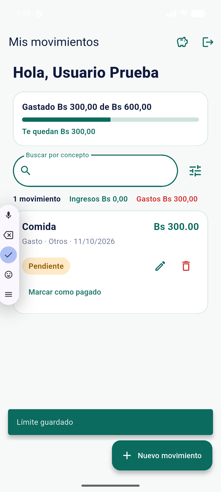
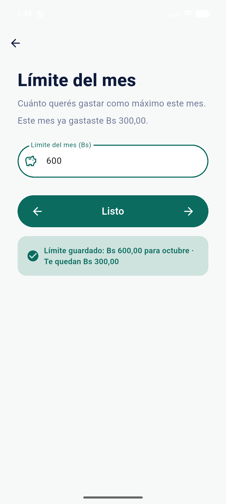

# Clase 15 · Evaluación heurística (Nielsen)

## 1. Tarea evaluada

**"Configurar límite y registrar un gasto"**, desde la lista de movimientos hasta el resultado final.

| Paso | Pantalla | Qué hace la persona |
|---|---|---|
| 1 | Mis movimientos | Toca el ícono del chanchito (Límite del mes) en la barra superior. |
| 2 | Límite del mes | Escribe el límite (ej. 500) y toca **Guardar límite**. |
| 3 | Mis movimientos | Vuelve a la lista y ve la tarjeta "Gastado Bs X de Bs 500,00". |
| 4 | Mis movimientos | Toca **Nuevo movimiento**. |
| 5 | Nuevo movimiento | Elige el tipo Gasto y la categoría, y escribe el concepto, el monto y la fecha. |
| 6 | Nuevo movimiento | Toca **Guardar**. |
| 7 | Mis movimientos / Nuevo movimiento | Si el gasto entra en el límite, vuelve a la lista con el gasto y la tarjeta actualizada. Si lo supera, se queda en el formulario con un mensaje de bloqueo. |

## 2. Hallazgos

| # | Pantalla y evidencia | Problema y consecuencia | Heurística | Severidad |
|---|---|---|---|---|
| 1 | Paso 2 · Límite del mes: escribe 500 y toca **Guardar límite**. | Al tocar Guardar, la pantalla se cierra enseguida y la única confirmación es un mensaje genérico ("Límite guardado") que aparece abajo, en la pantalla siguiente, lejos del botón. En la prueba no se notó. La persona puede volver a tocar Guardar o pensar que no funcionó. | H1 · Visibilidad del estado del sistema | 3 · Mayor |
| 2 | Paso 6 · Nuevo movimiento: toca **Guardar** con un gasto que supera el límite. | El mensaje de bloqueo dice cuánto queda, pero no ofrece una salida (ni "cambiar el monto" ni "subir el límite"). La persona no sabe cómo continuar. | H9 · Reconocer, diagnosticar y recuperarse de errores | 2 · Menor |
| 3 | Paso 5 · Nuevo movimiento: elige Gasto y está por escribir el monto. | El formulario no muestra cuánto queda del límite del mes. La persona escribe el monto a ciegas y se entera de que se pasa recién cuando el sistema la bloquea. | H5 · Prevención de errores (y H6 · Reconocer antes que recordar) | 3 · Mayor |

Escala de severidad de Nielsen: 0 no es un problema · 1 cosmético · 2 menor · 3 mayor · 4 catástrofe.

## 3. Fichas

### Hallazgo 1 · Límite guardado sin confirmación cerca de la acción
- **Dónde:** pantalla Límite del mes, al tocar **Guardar límite** (paso 2).
- **Qué ocurre:** la pantalla se cierra en el mismo momento en que se guarda. La única confirmación es un mensaje flotante, "Límite guardado", que aparece abajo, sobre la lista, sin el monto ni el mes.
- **Consecuencia:** la persona no sabe si su límite quedó guardado. Puede volver a entrar y guardarlo de nuevo, o desconfiar de la app.
- **Heurística y por qué esa:** H1 · Visibilidad del estado del sistema. El sistema hizo bien su trabajo, pero no lo comunica donde la persona está mirando (junto al botón) ni el tiempo suficiente para verlo. No es H9 porque no hay ningún error, y no es un problema de lenguaje: falta la respuesta del sistema a la acción.
- **Por qué esa severidad:** 3 · Mayor.
  - Frecuencia: pasa cada vez que alguien guarda un límite.
  - Impacto: el límite es la base de todo el control de gastos; si la persona duda de que se guardó, duda de lo demás.
  - Persistencia: no se aprende a evitarlo; se repite en cada uso.
  - No es 4 porque el dato sí se guarda y la tarjeta de la lista lo muestra al volver.
- **Causa en el código:** `lib/pantallas/pantalla_limite.dart:65-68` muestra el mensaje y hace `Navigator.pop` enseguida. El mensaje es un SnackBar flotante (`lib/widgets/mensajes.dart:7-11`) que queda en la pantalla siguiente. El resumen que devuelve el servidor (`servidor/servidor.js:400`: mes, límite, gastado y restante) no se usa en la línea 65.

### Hallazgo 2 · Bloqueo sin salida
- **Dónde:** pantalla Nuevo movimiento, al tocar **Guardar** con un gasto que supera el límite (paso 6).
- **Qué ocurre:** aparece en rojo: "Con este gasto llegarías a Bs 530,00 y tu límite es Bs 500,00. Te quedan Bs 50,00." El mensaje no tiene botones ni sugiere qué hacer.
- **Consecuencia:** la persona entiende que no puede, pero no sabe cómo seguir: ¿baja el monto?, ¿sube el límite?, ¿dónde?
- **Heurística y por qué esa:** H9 · Reconocer, diagnosticar y recuperarse de errores. El mensaje cumple dos de las tres partes que pide H9 (dice el problema en lenguaje claro y con números exactos), pero no propone una solución.
- **Por qué esa severidad:** 2 · Menor. Solo aparece cuando el gasto supera el límite, y el mensaje ya da el dato necesario ("Te quedan Bs 50,00") para corregir el monto. La persona puede salir sola, aunque le cueste más.
- **Causa en el código:** el texto se arma en `servidor/limite.js:43` y llega con un 422 (`servidor/servidor.js:210`). La pantalla lo muestra como cualquier error (`lib/pantallas/pantalla_nuevo_movimiento.dart:104-106`) con un SnackBar sin acción (`lib/widgets/mensajes.dart:8-12`). `ErrorAcceso` guarda solo el texto, no el código HTTP (`lib/servicios/servicio_acceso.dart:8-11`), así que la pantalla no puede distinguir un bloqueo por límite de otro error.

### Hallazgo 3 · Gasto a ciegas
- **Dónde:** pantalla Nuevo movimiento, antes de escribir el monto (paso 5).
- **Qué ocurre:** el formulario no muestra cuánto queda del límite del mes. Ese dato solo está en la tarjeta de la lista, que queda tapada al abrir el formulario.
- **Consecuencia:** la persona escribe un monto sin saber si entra y se entera recién cuando el sistema la bloquea (hallazgo 2).
- **Heurística y por qué esa:**
  - H5 · Prevención de errores: es mejor evitar el error que explicarlo bien después. Con el restante a la vista, el bloqueo no llegaría a pasar.
  - H6 · Reconocer antes que recordar: la persona tiene que acordarse del número que vio en la otra pantalla.
- **Por qué esa severidad:** 3 · Mayor. Afecta a cada gasto que se registra cerca del límite, termina en un error y obliga a volver a empezar. No es 4 porque el servidor igual bloquea y no se pierde ningún dato.
- **Causa en el código:** `lib/pantallas/pantalla_nuevo_movimiento.dart:33-45` no pide el límite al abrir. El `build` (`:186-225`) no tiene ningún texto con el restante, y el campo monto (`:211-225`) no tiene `alCambiar`, así que no puede calcular nada mientras se escribe. El dato ya existe: `GET /limite` devuelve `restante` (`servidor/servidor.js:375`) y la app ya lo lee (`lib/servicios/servicio_limite.dart:25-28`), pero solo lo usa la tarjeta de la lista (`lib/pantallas/pantalla_movimientos.dart:443-485`).

## 4. Hallazgo elegido: el 1

Se eligió el **hallazgo 1** por su **impacto en la tarea**. Configurar el límite es el primer paso, y todo el control de gastos depende de él: la tarjeta, el aviso al 80 % y el bloqueo. Si la persona no ve que su límite quedó guardado, no sabe si la app la está cuidando. Puede repetir la acción o dejar de confiar en lo que muestra después.

No se eligió por ser el cambio más rápido. Los hallazgos 2 y 3 quedan registrados como pendientes (sección 7).

## 5. Mejora

| Observación | Heurística | Severidad | Mejora | Comprobación |
|---|---|---|---|---|
| Al guardar el límite, la pantalla se cierra y la única confirmación es un mensaje genérico abajo, en la pantalla siguiente. | H1 · Visibilidad del estado del sistema | 3 · Mayor | Al tocar Guardar, la pantalla **no se cierra sola**. Junto al botón aparece una confirmación con el color y el ícono de éxito: "Límite guardado: Bs 500,00 para octubre · Te quedan Bs 180,00". Usa el resumen que ya devuelve el servidor. El botón pasa a **Listo** y recién ahí vuelve a la lista, que se recarga como hoy. Se quita el SnackBar para que no haya dos mensajes. | Otra persona define un límite **sin ayuda** y explica qué ocurrió. Si dice "se guardó, Bs X para octubre" sin dudar, el problema se resolvió. |

## 6. Estado de la mejora

- **Archivos cambiados:**
  - `lib/modelos/limite.dart`: `nombreMes` y `textoConfirmacionLimite` (función pura); `ResumenLimite` lee el `mes` que ya manda el servidor.
  - `lib/pantallas/pantalla_limite.dart`: al guardar ya no hay SnackBar ni `pop`; se muestra la confirmación junto al botón (verde claro, ícono de éxito), el botón pasa a **Listo** y, si se edita el monto, vuelve **Guardar límite**.
  - `lib/pantallas/pantalla_movimientos.dart`: la lista se recarga siempre al volver del límite (con **Listo** o con la flecha atrás).
  - `test/limite_validaciones_test.dart`: 3 pruebas nuevas (decimales con coma, nombre del mes, restante en 0).
- **Pruebas:** `flutter test` → 30 pasan · `flutter analyze` → 1 aviso `info` heredado.
- **Antes:** el único aviso aparece abajo, en la pantalla siguiente.

  
- **Después:** la confirmación queda junto al botón, con el monto, el mes y lo que queda, y el botón pasa a **Listo**.

  
- **Resultado de la comprobación:** Pendiente.

## 7. Pendientes

Los dos se resolvieron en la evaluación heurística H1–H10 (#18):

- **Hallazgo 2 → #23 (H9.1):** el mensaje de bloqueo ofrecería dos salidas, "Cambiar monto" (pone el foco en el campo sin borrar lo escrito) y "Subir límite" (abre la pantalla del límite). Para eso, `ErrorAcceso` tiene que guardar el código HTTP y así distinguir el 422.
- **Hallazgo 3 → #19 (H5.1):** el formulario mostraría "Te quedan Bs Z en octubre" (del mes de la fecha elegida, solo para gastos, sumando el monto anterior al editar) y, mientras se escribe, cuánto quedaría después del gasto, con color de aviso si se pasa.

## 8. Modalidad

P2 con IA (Claude Code).
