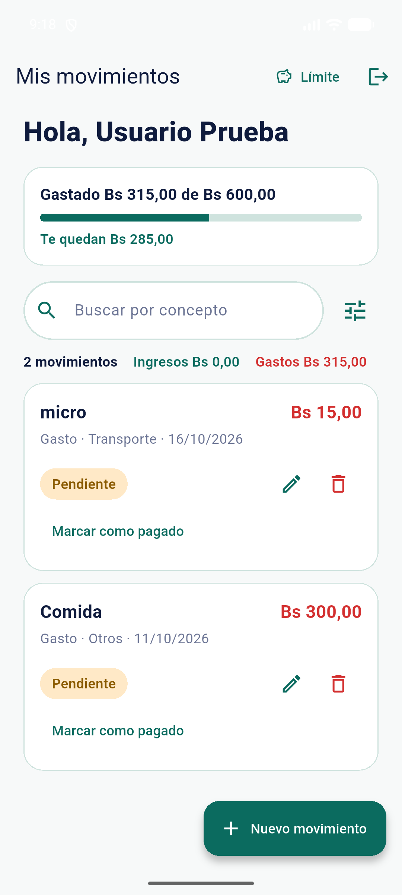
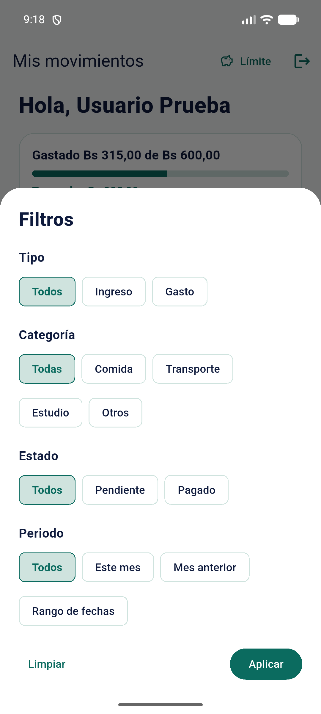
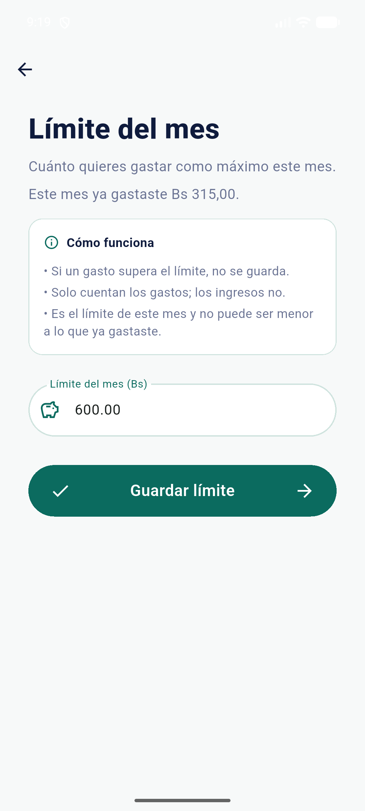
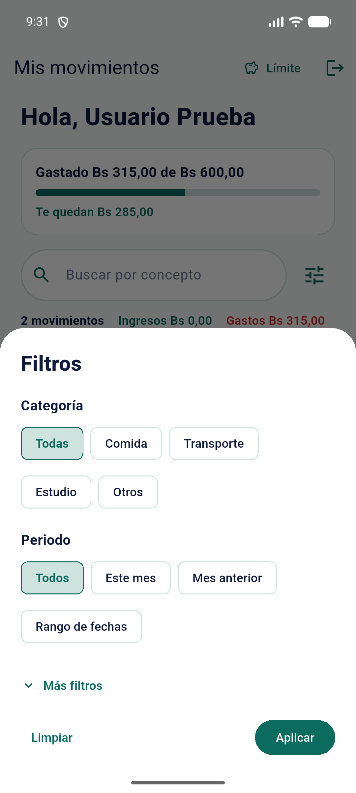
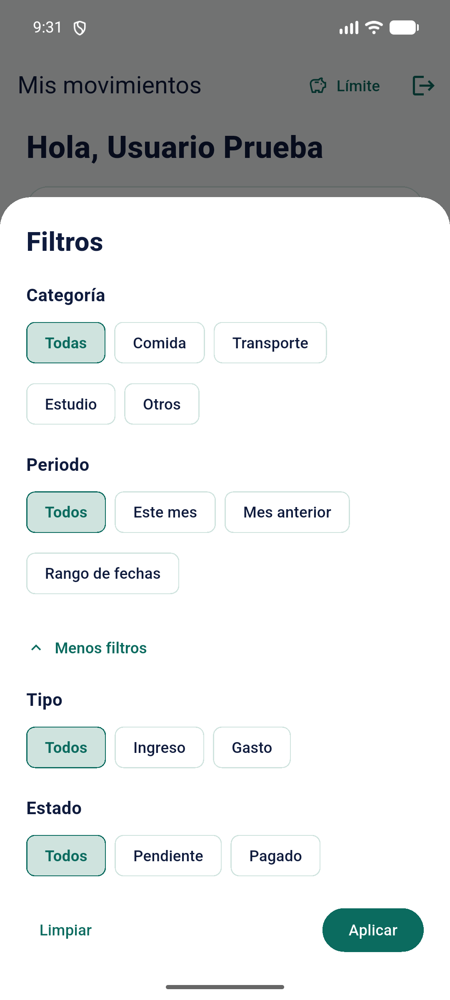
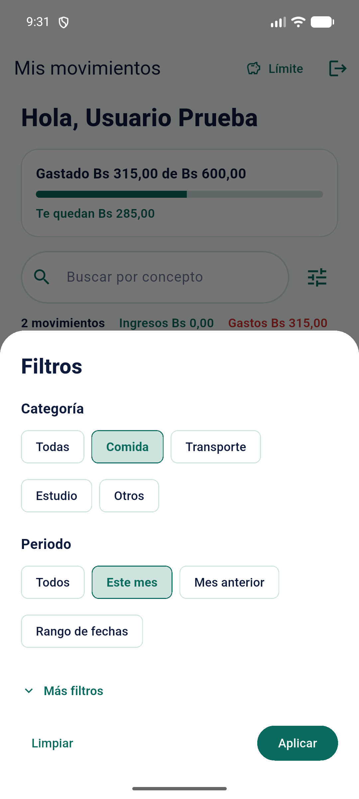
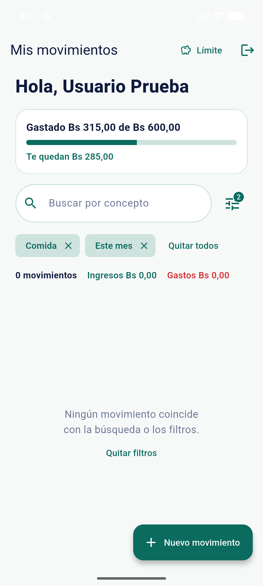
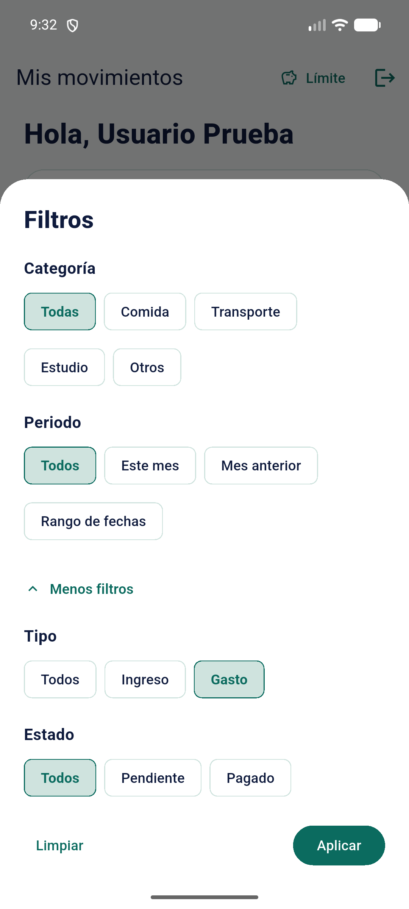

# Clase 16 · Decisiones de interacción (Fitts, Hick y carga cognitiva)

## 1. Tareas observadas

Se observó la app en el emulador (Pixel 6a) con el usuario de prueba, en las tres pantallas sugeridas: **registrar gasto**, **categorías** y **límite y disponible**. Cada hallazgo sale de una tarea concreta, no de la intuición.

| Tarea | Pantallas | Qué hace la persona |
|---|---|---|
| A · Cambiar el límite al ver que queda poco | Mis movimientos → Límite del mes | Lee "Te quedan Bs 285,00" en la tarjeta y quiere cambiar el límite. |
| B · Ver cuánto gastó en comida este mes | Mis movimientos → Filtros | Abre Filtros, elige la categoría Comida y el periodo Este mes, y toca Aplicar. |
| C · Subir el límite para que entre un gasto de Bs 400 | Nuevo movimiento → Límite del mes | Después del bloqueo, entra a Límite del mes y tiene que decidir qué monto escribir. |

## 2. Hallazgos

| Hallazgo | Captura obligatoria | Justificación breve | Estado al terminar |
|---|---|---|---|
| **Fitts** · La tarjeta del límite, grande y en el centro, no se puede tocar; el acceso es un botón chico en la esquina superior | Acción difícil de alcanzar: `evidencias/clase-16/01-antes-fitts-tarjeta-limite-no-se-toca.png` | **Tamaño y área activa:** la tarjeta mide 954 × 260 px y no es tocable; el botón "Límite" mide 246 × 126 px (unas 8 veces menos área). **Distancia:** el botón está en la esquina superior derecha, el punto más lejos del pulgar, mientras la persona está mirando la tarjeta. | Documentado |
| **Hick** · Los filtros muestran 15 opciones con el mismo peso, en 4 grupos abiertos a la vez | Opciones que compiten: `evidencias/clase-16/02-antes-hick-filtros-todos-abiertos.png` | **Cantidad y prioridad:** para "comida de este mes" solo hacen falta 2 opciones, pero compiten con otras 13 (tipo, estado, "Todos" repetido 3 veces). Nada indica cuáles se usan más. | Documentado y corregido (sección 5) |
| **Carga cognitiva** · Límite del mes no muestra cuánto queda: hay que recordar y restar | Información que exige esfuerzo: `evidencias/clase-16/03-antes-carga-limite-sin-disponible.png` | **Recordar y calcular:** "Te quedan Bs 285,00" estaba en la pantalla anterior. Aquí solo dice "ya gastaste Bs 315,00" y el campo "600.00". Para que entre un gasto de 400 hay que hacer 315 + 400 = 715 de memoria. **Interpretar:** el campo usa punto (600.00) y el resto de la app, coma. | Documentado |

## 3. Fichas

### Hallazgo 1 · Fitts (alcanzar) · La tarjeta del límite no es un área activa

- **Dónde:** Mis movimientos, tarjeta "Gastado Bs 315,00 de Bs 600,00 · Te quedan Bs 285,00" (tarea A).
- **Qué se observó:** se tocó el centro de la tarjeta y **no pasó nada**. La única forma de entrar a Límite del mes es el botón "Límite" de la barra superior.
- **Medición** (lectura de la pantalla con `uiautomator`, pantalla de 1080 × 2400 px):

  | Elemento | Tamaño | Posición | ¿Se puede tocar? |
  |---|---|---|---|
  | Tarjeta del límite | ≈ 954 × 260 px | Arriba de la lista, en el centro, donde se lee el dato | No (`clickable="false"`) |
  | Botón "Límite" | 246 × 126 px | Esquina superior derecha | Sí |

- **Por qué Fitts:** el tiempo para alcanzar un objetivo crece con la **distancia** y baja con el **tamaño**. Aquí el objetivo grande y cercano a la mirada (la tarjeta) no sirve, y el que sirve es chico y está en la zona más difícil para el pulgar (arriba, en el borde). No es Hick, porque no hay opciones que elegir: hay una sola acción. Tampoco es carga cognitiva, porque la persona sabe qué quiere hacer; lo difícil es llegar al botón.
- **Código:** `lib/pantallas/pantalla_movimientos.dart:463-505`: `_tarjetaLimite` devuelve un `Container` sin `InkWell` ni `onTap`. El acceso real está en `:272-282` (`TextButton.icon` "Límite", en `AppBar.actions`). La acción que abre la pantalla ya existe: `_abrirLimite`, en `:136`.
- **Mejora propuesta:** que toda la tarjeta sea tocable (`InkWell` con `onTap: _abrirLimite`), con un indicio visible, como "Cambiar límite ›". El botón de la barra se mantiene.

### Hallazgo 2 · Hick (elegir) · Todos los filtros abiertos con el mismo peso

- **Dónde:** Mis movimientos → Filtros (tarea B: "¿cuánto gasté en comida este mes?").
- **Qué se observó:** la hoja muestra **4 grupos y 15 opciones** al mismo tiempo, todas con el mismo tamaño y color: Tipo (Todos, Ingreso, Gasto), Categoría (Todas, Comida, Transporte, Estudio, Otros), Estado (Todos, Pendiente, Pagado) y Periodo (Todos, Este mes, Mes anterior, Rango de fechas). Hay "Todos" tres veces. Para la tarea solo hacen falta 2 de las 15.
- **Por qué Hick:** el tiempo de decisión crece con la **cantidad** de opciones que compiten y con la falta de **prioridad**. Las que más se usan para ver en qué se gasta (categoría y periodo) tienen el mismo peso que las que se usan poco (tipo y estado). No es Fitts, porque cada chip es fácil de tocar (126 px de alto). Tampoco es carga cognitiva, porque no hay que recordar ni calcular: el esfuerzo es elegir.
- **Código:** `lib/widgets/hoja_filtros.dart:170-210` arma los 4 grupos seguidos con `_grupo<T>` (`:91-134`), que muestra todas las opciones de cada grupo sin ningún orden de importancia.
- **Mejora propuesta:** dejar a la vista **Categoría y Periodo** (lo frecuente) y mover Tipo y Estado a "Más filtros", plegado, como en el ejemplo "Prioridad" de la clase.

### Hallazgo 3 · Carga cognitiva (comprender) · El límite sin "disponible"

- **Dónde:** Límite del mes (tarea C: la persona fue bloqueada por un gasto de Bs 400 y entra a subir el límite).
- **Qué se observó:** la pantalla muestra "Este mes ya gastaste Bs 315,00" y el campo con "600.00", pero **no dice cuánto queda**. Ese dato ("Te quedan Bs 285,00") se veía en la pantalla anterior. Para decidir el nuevo límite, la persona tiene que:
  1. **recordar** lo que vio antes, o **calcular** 600 − 315 = 285;
  2. **calcular** cuánto necesita: 315 + 400 = 715;
  3. **interpretar** "600.00" con punto, cuando en el resto de la app el mismo dinero se escribe con coma ("Bs 600,00").
- **Por qué carga cognitiva:** el esfuerzo es **mental** (recordar, calcular y comparar formatos), no de alcance ni de elección: hay un solo campo y un solo botón. No es Fitts ni Hick.
- **Código:** `lib/pantallas/pantalla_limite.dart:178-184` solo muestra lo gastado; no hay ningún texto con el restante, aunque `ResumenLimite` ya trae `restante` (`lib/modelos/limite.dart:60`). El campo se llena con `toStringAsFixed(2)` en `:50` (con punto).
- **Mejora propuesta:** mostrar "Límite actual Bs 600,00 · Te quedan Bs 285,00" y, mientras se escribe, "Con este límite te quedarían Bs X", con el mismo cálculo en centavos que `avisoGasto`. El campo se llenaría con coma.

## 4. Mejora elegida: hallazgo 2 (Hick)

Se eligió el **hallazgo 2 (Hick, filtros)**.

- **Por qué este:** filtrar por categoría y periodo es la forma de responder "¿en qué gasto mi dinero?", que es el objetivo de la app. Hoy esa decisión compite con 13 opciones que casi no se usan para eso.
- **Qué se hará:** en la hoja de Filtros quedan a la vista **Categoría y Periodo**, lo frecuente. **Tipo y Estado** pasan a "Más filtros", plegado. Si alguno de ellos ya está activo, "Más filtros" muestra cuántos y se abre solo, para que no queden filtros escondidos.
- **Comprobación:** se repite la tarea B ("¿cuánto gasté en comida este mes?"). Las dos opciones necesarias tienen que estar en los dos primeros grupos y quedar menos opciones a la vista (de 15 a 9). Además, otra persona, sin ayuda, filtra la comida de este mes y explica qué hizo.

## 5. Mejora aplicada

| Observación | Principio | Mejora | Comprobación |
|---|---|---|---|
| Los filtros muestran 15 opciones con el mismo peso, en 4 grupos abiertos, y para la tarea solo hacen falta 2. | Hick · cantidad y prioridad | A la vista quedan Categoría y Periodo (lo frecuente). Tipo y Estado pasan a "Más filtros", plegado. Si alguno está activo, se abre solo, y plegado dice "Más filtros (N)". | Se repitió la tarea B: Comida y Este mes están en los dos primeros grupos, y a la vista hay 9 opciones en lugar de 15. Con Tipo = Gasto activo, al volver a abrir, "Más filtros" ya aparece desplegado. |

- **Archivo cambiado:** `lib/widgets/hoja_filtros.dart` (solo la interfaz; la regla de filtrado, el servidor y las pruebas no cambian).
  - `:39`: `late bool _masFiltros = widget.actual.tipo != null || widget.actual.estado != null;` Plegado por defecto, y desplegado si Tipo o Estado ya tienen un filtro activo, para que no quede ningún filtro escondido.
  - `:139-156`: `_botonMasFiltros()`, un `TextButton.icon` que alterna `_masFiltros`. Plegado, muestra cuántos de los filtros ocultos están activos ("Más filtros (1)").
  - `:192-225`: Categoría y Periodo (con su rango de fechas) van primero.
  - `:226-248`: el botón, y debajo, solo si `_masFiltros` es verdadero, los grupos Tipo y Estado.
- **Pruebas:** `flutter test` → 36 pasan · `flutter analyze` → 1 aviso `info` heredado.
- **Antes:** 4 grupos y 15 opciones abiertas.

  
- **Después:** a la vista, Categoría y Periodo (9 opciones) y "Más filtros".

  
- **Más filtros desplegado:** Tipo y Estado siguen disponibles.

  
- **Tarea B con la mejora:** Comida y Este mes elegidos sin abrir "Más filtros"; al aplicar, la lista muestra los chips "Comida" y "Este mes". Sale vacía porque el único gasto "Comida" de los datos de prueba está guardado en la categoría Otros.

  
  
- **Filtro oculto activo:** con Tipo = Gasto aplicado, al volver a abrir los filtros, "Más filtros" ya está desplegado y muestra Gasto marcado.

  
- **Comprobación con otra persona:** pendiente (filtrar "comida de este mes" sin ayuda y explicar qué hizo).

## 6. Entrega

| Paso | Commit | Estado |
|---|---|---|
| 1 | `docs: registrar hallazgos de interacción`: este documento, las 3 capturas del antes y la mejora elegida | Hecho |
| 2 | `fix: aplicar mejora de interacción`: `hoja_filtros.dart` con la prioridad en los filtros y las capturas del después en `docs/evidencias/clase-16/` | Hecho |

