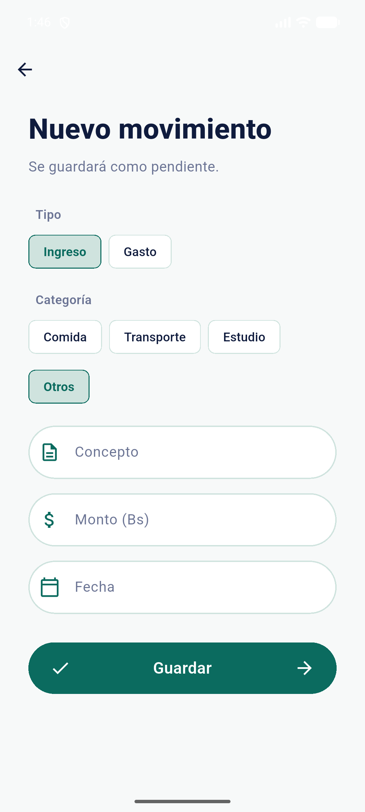
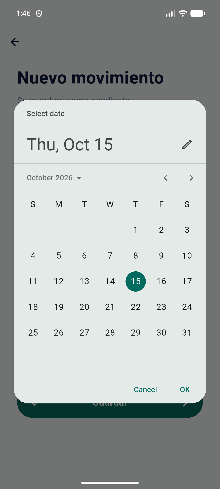
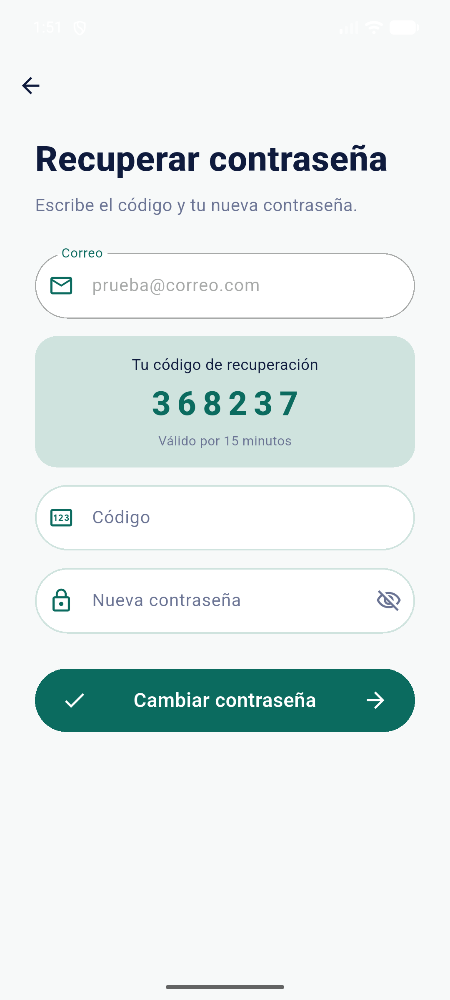
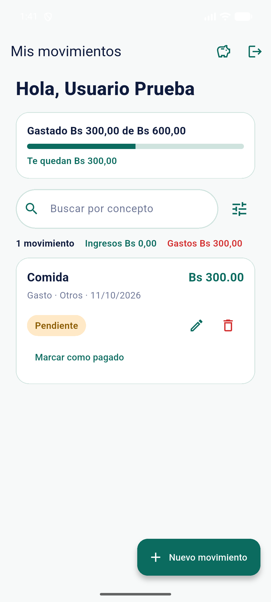
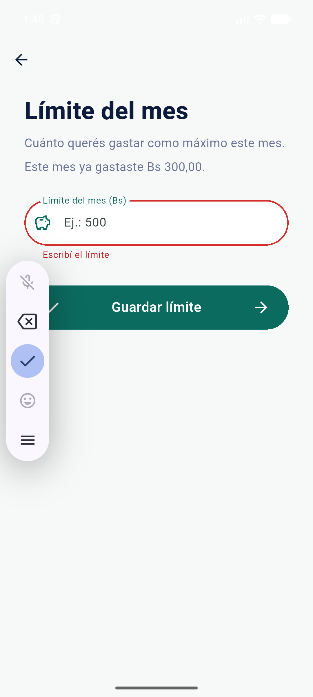
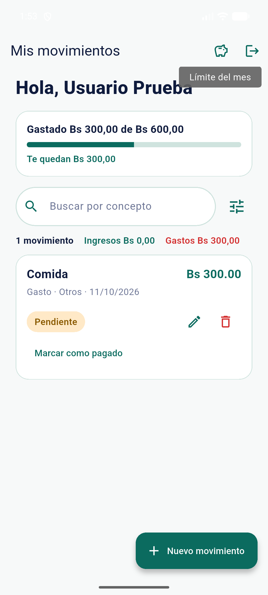
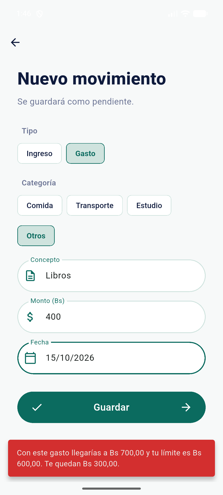
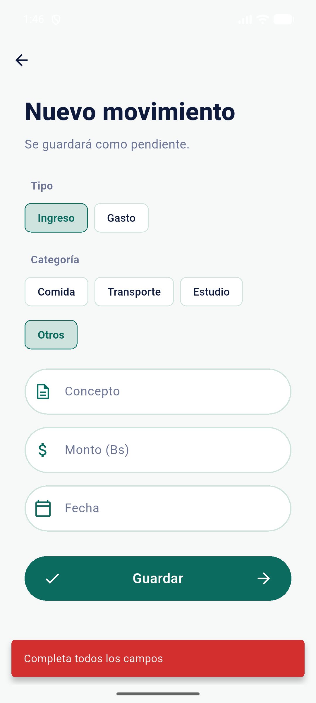
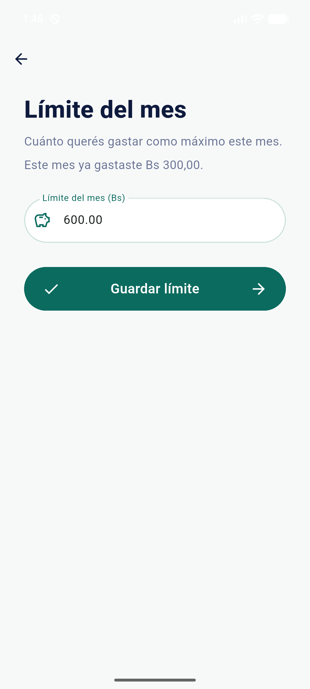

# Análisis heurístico H1–H10 · estado "antes"

Recorrido hecho el 14/10/2026 en el emulador (Pixel 6a), con el usuario de prueba y el código de la rama `clase` (`9a81361`).
Solo se analizó: **no se cambió código**. Las capturas están en `antes/`.

Escala de severidad de Nielsen: 0 no es problema · 1 cosmético · 2 menor · 3 mayor · 4 catástrofe.

---

## Resumen

| H | Heurística | Estado hoy | Hallazgos | Severidad más alta |
|---|---|---|---|---|
| H1 | Visibilidad del estado del sistema | **Cumple** (corregida en la clase 15) | — | — |
| H2 | Relación con el mundo real | **Falla** | 2.1, 2.2, 2.3 | 2 |
| H3 | Control y libertad | **Falla** | 3.1, 3.2, 3.3 | 2 |
| H4 | Consistencia y estándares | **Falla** | 4.1, 4.2, 4.3, 4.4 | 2 |
| H5 | Prevención de errores | **Falla** | 5.1, 5.2, 5.3 | 3 |
| H6 | Reconocer antes que recordar | **Falla** | 6.1 | 2 |
| H7 | Flexibilidad y eficiencia | **Falla** | 7.1 | 2 |
| H8 | Diseño estético y minimalista | **Cumple** | — | — |
| H9 | Reconocer y recuperarse de errores | **Falla** | 9.1, 9.2, 9.3 | 2 |
| H10 | Ayuda y documentación | **Falla** | 10.1 | 2 |

**2 cumplen, 8 fallan, con 19 hallazgos.** Casi todos son cambios chicos (textos, íconos, un valor por defecto). Los más grandes son 5.1 (restante en el formulario) y 9.1 (salidas del bloqueo).

---

## H1 · Visibilidad del estado del sistema → CUMPLE

- **Dónde se comprobó:**
  - Límite del mes: al guardar, la confirmación aparece junto al botón: "Límite guardado: Bs 600,00 para octubre · Te quedan Bs 300,00". Es la corrección de la clase 15, y **esta captura es el "después" que faltaba**.
  - Mis movimientos: la tarjeta "Gastado X de Y" tiene barra y cambia de color al 80 %. La línea de totales, los chips de filtros activos y el contador en el ícono de filtros muestran el estado.
  - Los botones cambian por un indicador de carga mientras se guarda.
- **Código:** `lib/pantallas/pantalla_limite.dart:87-107` y `:165-180` · `lib/pantallas/pantalla_movimientos.dart:444-486` (tarjeta), `:372-397` (totales), `:338-369` (chips), `:326-331` (contador).
- **Capturas:** `antes/h1-limite-confirmacion-ya-corregida.png`, `antes/h1-h9-busqueda-sin-resultados.png`

> Detalle menor, no bloquea el "cumple": al buscar no aparece ningún indicador mientras llega la respuesta (`pantalla_movimientos.dart:72-92` no pone `_cargandoLista = true`). Se puede dejar así.

---

## H2 · Relación entre el sistema y el mundo real → FALLA

### 2.1 · Un ingreso se guarda como "pendiente" y se puede "marcar como pagado" · Severidad 2
- **Dónde:** Nuevo movimiento con tipo **Ingreso**. El subtítulo dice "Se guardará como pendiente". En la lista, un ingreso muestra el chip "Pendiente" y el botón "Marcar como pagado".
- **Problema:** en la vida real un ingreso no se "paga": se **cobra** o se **recibe**. La persona no entiende qué significa "pagar" un sueldo o una beca.
- **Código:** `lib/pantallas/pantalla_nuevo_movimiento.dart:187` (subtítulo fijo) · `lib/pantallas/pantalla_movimientos.dart:531-566` (chip y botón iguales para los dos tipos) · `lib/modelos/movimiento.dart:8-10` (`texto` del estado).
- **Idea de corrección (solo textos, no cambia la regla de la Tarea 2):** si es ingreso, mostrar "Por cobrar" / "Cobrado" / "Marcar como cobrado".
- **Captura:** `antes/h2-ingreso-se-guarda-como-pendiente.png`

### 2.2 · El calendario está en inglés · Severidad 2
- **Dónde:** al tocar Fecha en Nuevo/Editar movimiento y en Filtros → Rango de fechas.
- **Problema:** dice "Select date", "Thu, Oct 15", "Cancel", "OK" y los días en inglés (S M T W T F S). El resto de la app está en español.
- **Código:** `lib/main.dart:14-20` (no tiene `locale` ni `localizationsDelegates`); `pubspec.yaml` no tiene `flutter_localizations`. Los calendarios se abren en `pantalla_nuevo_movimiento.dart:57` y `widgets/hoja_filtros.dart:73`.
- **Captura:** `antes/h2-h4-calendario-en-ingles.png`

### 2.3 · El monto en bolivianos usa el ícono de dólar ($) · Severidad 1
- **Dónde:** campo "Monto (Bs)" en Nuevo/Editar movimiento.
- **Problema:** el ícono `$` representa dólares, pero la moneda es Bs.
- **Código:** `lib/pantallas/pantalla_nuevo_movimiento.dart:214` (`Icons.attach_money`).
- **Captura:** `antes/h5-h6-h7-formulario-nuevo-vacio.png`

---

## H3 · Control y libertad del usuario → FALLA

### 3.1 · La flecha atrás borra el formulario sin preguntar · Severidad 2
- **Dónde:** Nuevo movimiento con datos escritos ("Libros", 400, fecha) → flecha atrás.
- **Problema:** vuelve a la lista y se pierde todo lo escrito, sin un "¿Descartar cambios?". Pasa también en Editar.
- **Código:** `lib/pantallas/pantalla_nuevo_movimiento.dart:165-169` (Scaffold sin `PopScope`).
- **Capturas:** antes de tocar atrás, `antes/h5-h6-formulario-lleno-sin-restante.png`; después, `antes/h3-atras-descarta-formulario-sin-aviso.png` (no quedó nada).

### 3.2 · En Recuperar, paso 2, no se puede corregir el correo · Severidad 2
- **Dónde:** Recuperar contraseña después de "Obtener código".
- **Problema:** el correo queda deshabilitado (en gris) y no hay un "Cambiar correo". Si la persona se equivocó, la única salida es salir de la pantalla y empezar de cero. Ya estaba anotado en la bitácora del 10/10, observación 9.
- **Código:** `lib/pantallas/pantalla_recuperar.dart:118-124` (`habilitado: !enPaso2`); no hay forma de volver a poner `_codigoRecibido = null`.
- **Captura:** `antes/h3-recuperar-paso2-correo-bloqueado.png`

### 3.3 · "Cerrar sesión" actúa con un solo toque, sin confirmar · Severidad 1
- **Dónde:** el ícono ⏻ de Mis movimientos, que está pegado al 🐷 del límite.
- **Problema:** un toque por error saca a la persona de su cuenta. Volver a entrar exige escribir el correo y la contraseña.
- **Código:** `lib/pantallas/pantalla_movimientos.dart:264-268` y `:238-242`. Ya existe `_pedirConfirmacion` (`:154-188`) para reutilizar.
- **Captura:** `antes/h3-h6-inicio-tras-cerrar-sesion-sin-confirmar.png`

> **Lo que sí cumple en H3:** eliminar y marcar como pagado piden confirmación y se pueden cancelar (`antes/h3-h5-confirmar-eliminar.png`, `antes/h3-confirmar-pagado-irreversible.png`). Los filtros tienen "Limpiar", "Quitar todos" y la X en cada chip. Que "pagado" no se pueda deshacer es la regla de la Tarea 2; **no conviene tocarla**.

---

## H4 · Consistencia y estándares → FALLA

### 4.1 · El mismo dinero se escribe de dos formas: "Bs 300.00" y "Bs 300,00" · Severidad 2
- **Dónde:** Mis movimientos. La tarjeta dice **Bs 300.00** (punto), y la tarjeta del límite y los totales dicen **Bs 300,00** (coma). En Editar, el monto aparece como "300.00".
- **Código:** `lib/modelos/movimiento.dart:105` (`montoTexto` con punto) frente a `lib/modelos/limite.dart:21` (`formatearBs` con coma). Se usa en `pantalla_movimientos.dart:514` y en `pantalla_nuevo_movimiento.dart:39`.
- **Captura:** `antes/h4-h8-lista-formato-y-color-monto.png`

### 4.2 · El monto de un gasto sale en verde, pero arriba los gastos van en rojo · Severidad 2
- **Dónde:** misma pantalla. La línea de totales usa verde para ingresos y rojo para gastos. La tarjeta pinta **todos** los montos de verde, sean ingreso o gasto.
- **Código:** `lib/pantallas/pantalla_movimientos.dart:513-520` (siempre `Colores.verdeOscuro`) frente a `:386-393` (rojo para gastos).
- **Captura:** la misma de 4.1.

### 4.3 · Pantalla del límite con voseo, y el resto de la app con "tú" · Severidad 1
- **Dónde:** Límite del mes dice "Cuánto **querés** gastar…" y sus errores dicen "**Escribí** el límite" y "**Usá** como máximo 2 decimales". El resto dice "Escribe", "Completa", "Modifica" (tú).
- **Código:** `lib/pantallas/pantalla_limite.dart:133` · `lib/modelos/limite.dart:2` y `:4` · `servidor/limite.js:13` y `:19` (el mismo mensaje va en las dos capas).
- **Capturas:** `antes/h2-h4-h10-pantalla-limite.png`, `antes/h4-limite-vacio-voseo-escribi.png`

### 4.4 · Los botones siempre llevan "→", y "Listo" tiene flechas para los dos lados · Severidad 1
- **Dónde:** el botón "Listo" del límite muestra ← a la izquierda y → a la derecha a la vez. "Guardar" y "Guardar cambios" también llevan →, aunque no avanzan a ningún lado.
- **Código:** `lib/widgets/boton_pildora.dart:49` (`Icons.arrow_forward` fijo) · `lib/pantallas/pantalla_limite.dart:166-169` (`icono: Icons.arrow_back`).
- **Captura:** `antes/h1-limite-confirmacion-ya-corregida.png`

> **Observación aparte (decidir, no es obligatorio):** las contraseñas se tapan con ✏ y no con puntos (`widgets/campo_texto.dart:57`). Se aleja del estándar de la plataforma, pero fue un pedido del equipo y la regla 1 dice que no se cambia sin avisar. Se ve en `antes/h9-login-error-snackbar-lejos.png`.

---

## H5 · Prevención de errores → FALLA

### 5.1 · El formulario no muestra cuánto queda del límite · Severidad 3
- Es el **hallazgo 3 de la clase 15**, y sigue pendiente.
- **Dónde:** Nuevo movimiento, al escribir el monto de un gasto. La persona escribe 400 sin saber que solo le quedan Bs 300, y se entera recién cuando la bloquean (ver 9.1).
- **Código:** `lib/pantallas/pantalla_nuevo_movimiento.dart:33-45` (no pide el límite) y `:211-225` (el monto no tiene `alCambiar`). El dato ya existe en `ServicioLimite.leer()` (`lib/servicios/servicio_limite.dart:25-28`).
- **Captura:** `antes/h5-h6-formulario-lleno-sin-restante.png`

### 5.2 · El registro acepta un correo sin "@" · Severidad 2
- **Dónde:** Crear cuenta.
- **Problema:** ni la app ni el servidor revisan el formato. Con un correo mal escrito, después no se puede iniciar sesión ni recuperar la contraseña. Ya estaba anotado en la bitácora del 10/10, observación 5.
- **Código:** `lib/pantallas/pantalla_registro.dart:37-48` · `servidor/servidor.js:53-58`.
- **Captura:** `antes/h5-registro-sin-validar-correo.png`. **Falta la del error:** no se envió el formulario para no crear un usuario basura en la base. Para el "antes" se puede registrar `abc` y mostrar que lo acepta (y después borrar ese usuario, con permiso).

### 5.3 · La categoría viene preelegida en "Otros" · Severidad 1
- **Dónde:** Nuevo movimiento. Si la persona no la cambia, todo queda en "Otros" y el filtro por categoría deja de servir. En los datos de prueba ya pasó: el concepto "Comida" está en la categoría "Otros".
- **Código:** `lib/pantallas/pantalla_nuevo_movimiento.dart:27` (`CategoriaMovimiento.otros`).
- **Captura:** `antes/h5-h6-h7-formulario-nuevo-vacio.png` y `antes/h4-h8-lista-formato-y-color-monto.png` ("Comida · Otros").

> **Lo que sí cumple en H5:** eliminar y pagar piden confirmación. Un movimiento pagado bloquea el monto con candado. El límite no puede quedar por debajo de lo gastado.

---

## H6 · Reconocer antes que recordar → FALLA

### 6.1 · Las acciones de la barra superior son solo íconos, sin texto · Severidad 2
- **Dónde:** Mis movimientos. El 🐷 (Límite del mes) y el ⏻ (Cerrar sesión) no tienen texto. El nombre aparece solo si se **mantiene presionado** el ícono, algo que casi nadie hace en un celular.
- **Problema:** la persona tiene que **recordar** que el chanchito es el límite. En la prueba de la clase 15 hubo que decirle "toca el chanchito".
- **Código:** `lib/pantallas/pantalla_movimientos.dart:259-268` (solo `tooltip`).
- **Captura:** `antes/h6-iconos-sin-texto-solo-tooltip.png`

> El restante del límite, que no se ve en el formulario, también es de H6. Se corrige con el 5.1.

---

## H7 · Flexibilidad y eficiencia de uso → FALLA

### 7.1 · La fecha viene vacía: hay que abrir el calendario en cada movimiento · Severidad 2
- **Dónde:** Nuevo movimiento. Casi siempre la fecha es **hoy**, pero hay que tocar Fecha y después OK (2 toques extra cada vez). Si la persona lo olvida, aparece "Completa todos los campos".
- **Código:** `lib/pantallas/pantalla_nuevo_movimiento.dart:25` (`DateTime? _fecha;` empieza en null) y `:75`.
- **Captura:** `antes/h5-h6-h7-formulario-nuevo-vacio.png`

> **Lo que sí cumple en H7:** la búsqueda se hace mientras se escribe (`pantalla_movimientos.dart:95-102`). Hay periodos rápidos ("Este mes", "Mes anterior") y se pueden combinar filtros (`antes/h7-hoja-filtros.png`).

---

## H8 · Diseño estético y minimalista → CUMPLE

- **Dónde se comprobó:** la lista muestra lo justo: el saludo, la tarjeta del límite (solo si hay límite), el buscador, el total y las tarjetas. Los filtros están escondidos en una hoja y sus chips aparecen solo cuando hay alguno activo. Los formularios siguen el mismo orden y espaciado.
- **Código:** `lib/pantallas/pantalla_movimientos.dart:283-302` (estructura), `:292-296` (tarjeta solo con límite), `:338-341` (chips solo si hay activos) · `lib/widgets/hoja_filtros.dart`.
- **Capturas:** `antes/h4-h8-lista-formato-y-color-monto.png`, `antes/h7-hoja-filtros.png`

---

## H9 · Reconocer, diagnosticar y recuperarse de errores → FALLA

### 9.1 · El bloqueo por límite no ofrece una salida · Severidad 2
- Es el **hallazgo 2 de la clase 15**, y sigue pendiente.
- **Dónde:** Nuevo movimiento, con un gasto de 400 cuando quedan 300. Sale en rojo: "Con este gasto llegarías a Bs 700,00 y tu límite es Bs 600,00. Te quedan Bs 300,00." No hay botón "Cambiar monto" ni "Subir límite", y el mensaje se va solo a los pocos segundos.
- **Código:** `servidor/limite.js:43` · `servidor/servidor.js:210` (422) · `lib/pantallas/pantalla_nuevo_movimiento.dart:104-106` · `lib/widgets/mensajes.dart:4-13` (SnackBar sin acción) · `lib/servicios/servicio_acceso.dart:8-11` (`ErrorAcceso` no guarda el código HTTP).
- **Captura:** `antes/h9-bloqueo-limite-sin-salida.png`

### 9.2 · "Completa todos los campos" no dice cuál falta · Severidad 2
- **Dónde:** Nuevo movimiento, Login, Registro y Recuperar. El aviso sale abajo, desaparece y ningún campo se marca en rojo. En el formulario de movimiento hay 3 campos posibles.
- **Código:** `lib/pantallas/pantalla_nuevo_movimiento.dart:75-77` · `pantalla_login.dart:32-35` · `pantalla_registro.dart:37-48` · `pantalla_recuperar.dart:59-62`. `CampoTexto` ya tiene `error:` (`widgets/campo_texto.dart:14`) y lo usan el límite y los filtros.
- **Captura:** `antes/h9-error-campos-vacios-snackbar.png`. Para comparar, así se ve un error bien ubicado: `antes/h9-filtro-rango-error-en-linea.png`.

### 9.3 · Sin conexión al abrir la app, manda a Inicio sin explicar nada · Severidad 2
- **Dónde:** abrir la app con sesión guardada pero con el servidor apagado o sin internet.
- **Problema:** aparece la pantalla de bienvenida como si la sesión se hubiera cerrado. No dice "No se pudo conectar". La persona cree que perdió su cuenta.
- **Código:** `lib/pantallas/pantalla_arranque.dart:24-26` ("sin conexión: se trata como sin sesión").
- **Captura:** **pendiente.** Hace falta apagar el servidor, y no lo apagué porque estaba corriendo en tu terminal.

---

## H10 · Ayuda y documentación → FALLA

### 10.1 · La pantalla del límite no explica cómo funciona · Severidad 2
- **Dónde:** Límite del mes. Solo dice "Cuánto querés gastar como máximo este mes".
- **Problema:** no explica las reglas que después sorprenden: que **bloquea** los gastos que lo superan, que **solo cuentan los gastos** (los ingresos no), que es **por mes** y que no puede quedar por debajo de lo gastado.
- **Código:** `lib/pantallas/pantalla_limite.dart:131-143`. Las reglas están en `servidor/servidor.js:206-212` (solo gastos) y `servidor/limite.js:24-47`.
- **Captura:** `antes/h2-h4-h10-pantalla-limite.png`

> **Lo que sí hay:** la lista vacía dice "Crea el primero con el botón de abajo" (`pantalla_movimientos.dart:428-434`), el campo del límite tiene la pista "Ej.: 500" y el monto bloqueado explica su motivo (`pantalla_nuevo_movimiento.dart:226-242`).

---

## Sub-issues (uno por error: 19 en total)

H1 y H8 cumplen y no llevan sub-issue.

| Responsable | Sub-issue |
|---|---|
| Ariany | H5.1 · Mostrar cuánto queda del límite en el formulario |
| Ariany | H5.2 · Validar el formato del correo al registrarse |
| Ariany | H5.3 · Pedir la categoría en vez de preelegir "Otros" |
| Ariany | H7.1 · Poner la fecha de hoy por defecto |
| Ariany | H9.1 · Ofrecer salidas al bloqueo por límite |
| Ariany | H9.2 · Indicar qué campo falta completar |
| Ariany | H9.3 · Avisar cuando no hay conexión al abrir la app |
| Ariany | H10.1 · Explicar cómo funciona el límite del mes |
| Luis | H2.1 · Mostrar "Por cobrar" y "Cobrado" en los ingresos |
| Luis | H2.2 · Mostrar el calendario en español |
| Luis | H2.3 · Cambiar el ícono de dólar del monto en Bs |
| Luis | H3.1 · Confirmar antes de descartar un formulario |
| Luis | H3.2 · Permitir corregir el correo al recuperar la contraseña |
| Luis | H3.3 · Confirmar antes de cerrar sesión |
| Luis | H4.1 · Usar un solo formato de Bs en toda la app |
| Luis | H4.2 · Colorear el monto según si es ingreso o gasto |
| Luis | H4.3 · Cambiar el voseo por tuteo en el límite |
| Luis | H4.4 · Mostrar una sola flecha coherente en los botones |
| Luis | H6.1 · Dar un texto visible al acceso del límite |

**Cuidado con los conflictos:** H2, H3, H5, H7 y H9 tocan `pantalla_nuevo_movimiento.dart`. Hacer `git pull` antes de empezar cada sub-issue.

**Cuidado con las pruebas:** 4.1 y 4.3 cambian textos que ya revisan algunos tests (`test/limite_validaciones_test.dart`, `servidor/tests/limite.test.js`) y quizás `docs/historias/HU-01`. Hay que actualizarlos juntos.

## Qué quedó tocado en la app durante el análisis

- Se volvió a guardar el límite de octubre con **el mismo valor (600)** para ver la confirmación. El dato no cambió.
- Se pidió un código de recuperación para el usuario de prueba. No se usó y vence a los 15 minutos.
- Se cerró la sesión y se volvió a entrar.
- **No se creó, editó, pagó ni borró ningún movimiento.**

## Decidido

- Un sub-issue por error: 19 en total (Ariany 8, Luis 11). H1 y H8 no llevan.
- Se corrigen **todos** los errores, también los cosméticos.
- Reparto: Ariany H5, H7, H9 y H10 · Luis H2, H3, H4 y H6.
