# Clase 20 — Arquitectura de información

**Integrantes:** Sebastián Céspedes Rodas — Adolfo Mendoza Ribera  
**Fecha:** 05/11/2026  
**Producto:** UniBudget

## 1. Problema identificado

Los gastos recurrentes estaban mezclados con todos los movimientos. Para saber cuándo se cobra el próximo gasto recurrente y de qué monto era, la persona tenía que recorrer toda la lista y buscar las tarjetas con el chip “Recurrente”.

**Tarea difícil de encontrar:**

> “Encuentra cuándo se cobra el próximo gasto recurrente y de qué monto es”.

## 2. Propuesta de estructura

### Antes

```text
Mis movimientos
├── Límite del mes
├── Buscar / Filtros
├── Totales
└── Lista mezclada de movimientos normales y recurrentes
```

### Después

```text
Mis movimientos
├── Límite del mes
├── [ Todos ] [ Pendientes ] [ Pagados ] [ Recurrentes ]
├── Buscar / Filtros
├── Totales de la vista seleccionada
└── Lista agrupada por fecha:
    Vencidos (1)
    Hoy (2)
    Próximos (1)
    Anteriores (3)
```

### Dibujo de la propuesta

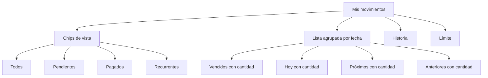

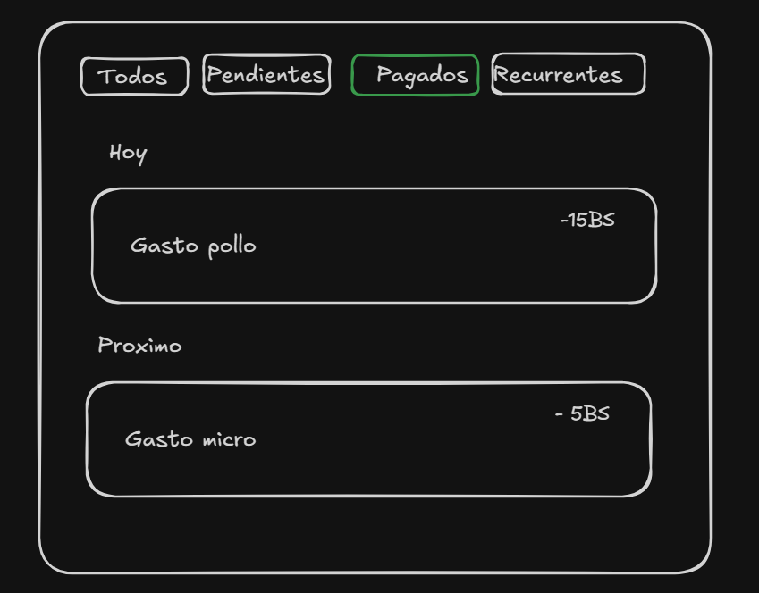

## 3. Motivo de la decisión

- **Agrupar:** los chips separan las vistas “Todos”, “Pendientes”, “Pagados” y “Recurrentes” sin sacar a la persona de “Mis movimientos”.
- **Agrupar por fecha:** la lista se divide en Vencidos, Hoy, Próximos y Anteriores, con la cantidad de movimientos en cada grupo.
- **Nombrar:** “Recurrentes” anticipa el contenido mejor que una opción genérica como “Gestionar”.
- **Jerarquizar:** los chips quedan arriba de la lista; la búsqueda y los filtros avanzados siguen disponibles debajo.
- **Navegación vs. filtros:** los chips son vistas rápidas; los filtros avanzados (tipo, categoría, estado, periodo) siguen dentro del botón de filtros.
- **Acceso:** con un toque en “Recurrentes” se muestran solo los movimientos recurrentes; la próxima ocurrencia queda en “Próximos”, ordenada de la más cercana a la más lejana.
- **Estados claros:** “Vencidos” agrupa pendientes con fecha pasada y “Anteriores” agrupa los pagados con fecha pasada.

## 4. Implementación

- Se agregaron los chips **Todos**, **Pendientes**, **Pagados** y **Recurrentes** en `PantallaMovimientos`.
- El chip cambia la lista visible y recalcula los totales de esa vista.
- **Todos:** muestra todos los movimientos.
- **Pendientes:** muestra solo los movimientos con estado pendiente.
- **Pagados:** muestra solo los movimientos con estado pagado.
- **Recurrentes:** muestra solo los movimientos marcados como recurrentes.
- La lista se agrupa por fecha y muestra la cantidad en cada encabezado:
  - **Vencidos:** pendientes con fecha anterior a hoy.
  - **Hoy:** movimientos con fecha de hoy.
  - **Próximos:** movimientos con fecha futura, ordenados del más cercano al más lejano.
  - **Anteriores:** movimientos pagados con fecha pasada.
- La búsqueda y los filtros avanzados siguen funcionando sobre la vista seleccionada.
- No se agregó una pantalla nueva ni un endpoint nuevo: la mejora es de arquitectura de información en la pantalla existente.
- “Historial” y “Límite” siguen disponibles desde la barra superior.

## 5. Capturas antes

### Movimientos

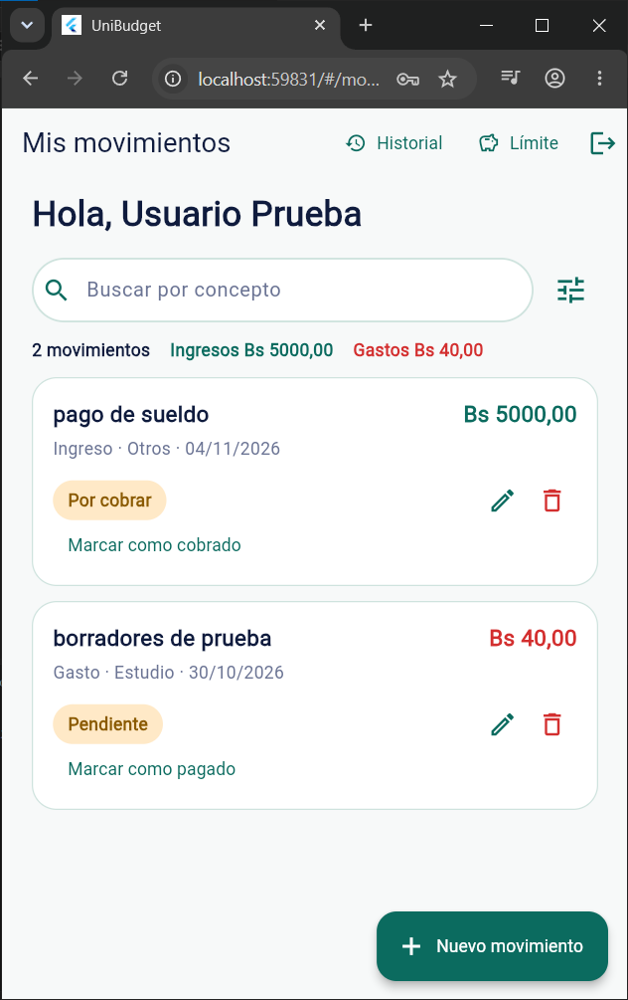

### Historial

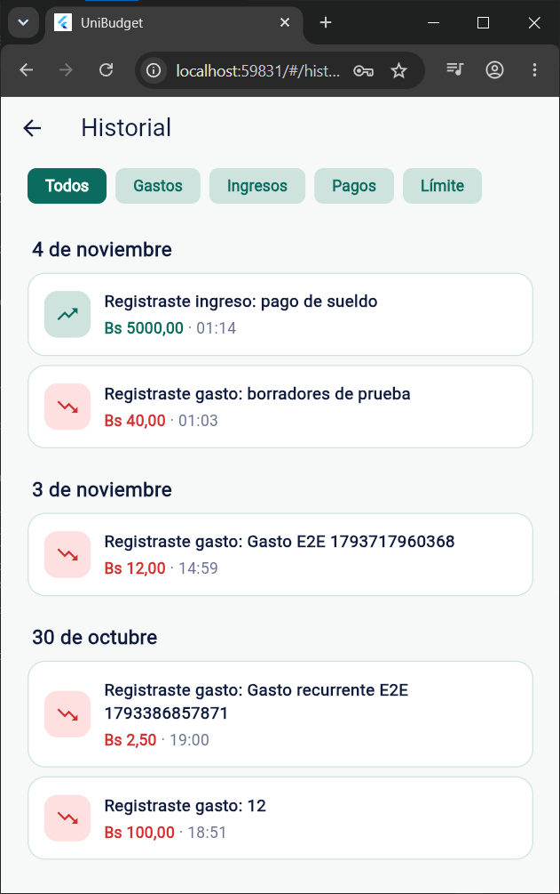

### Límite del mes

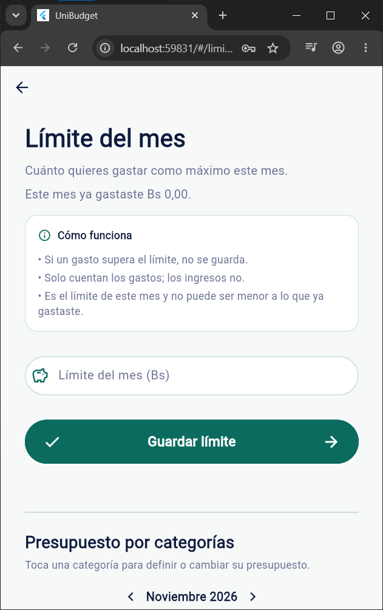

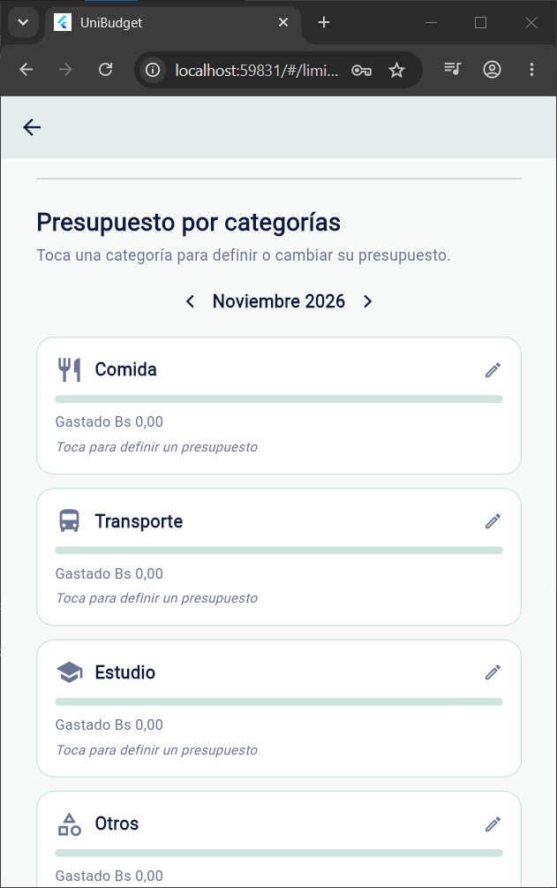

### Crear movimiento

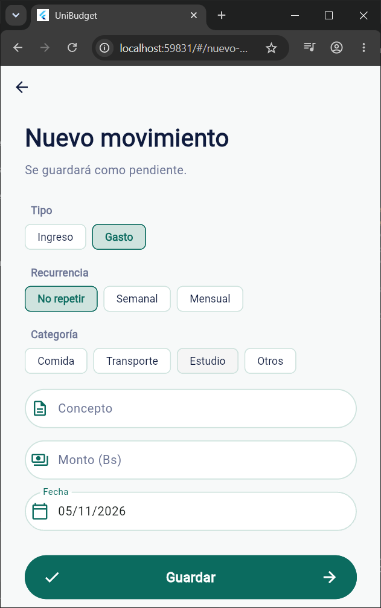

## 6. Capturas después

### Todos

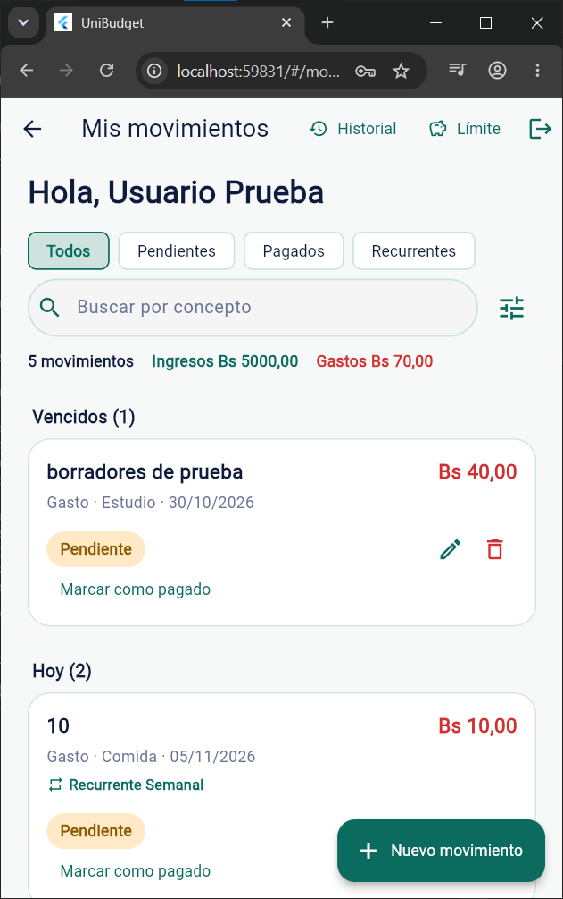

### Pendientes

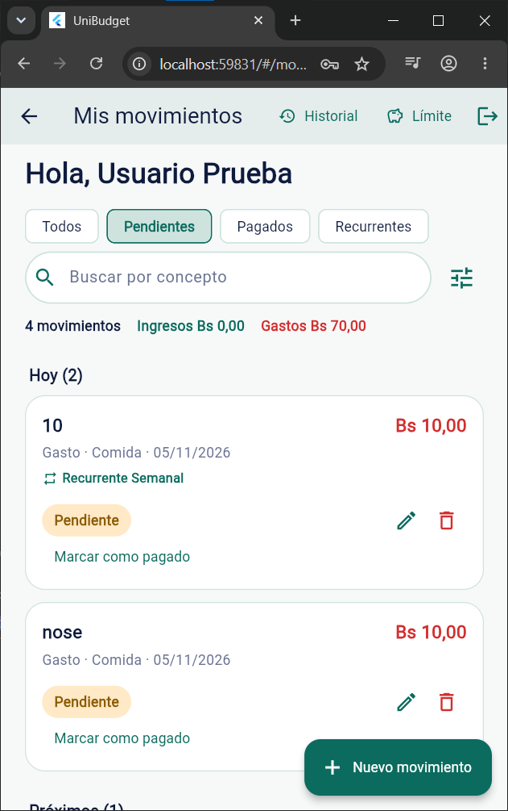

### Pagados

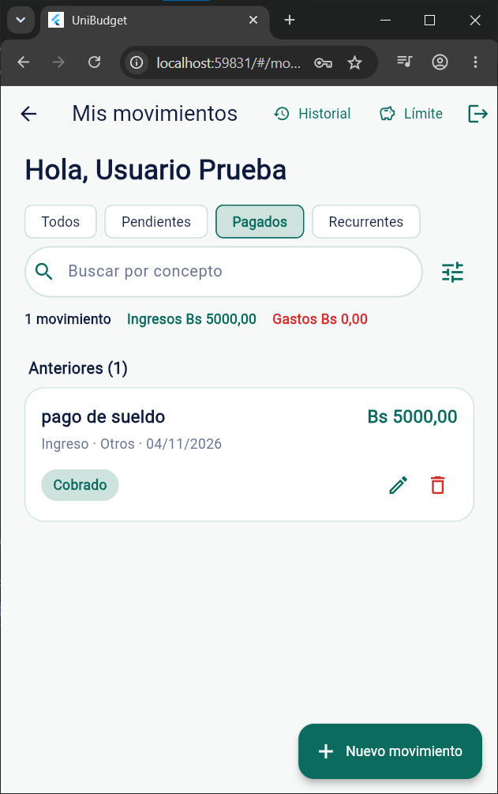

### Recurrentes

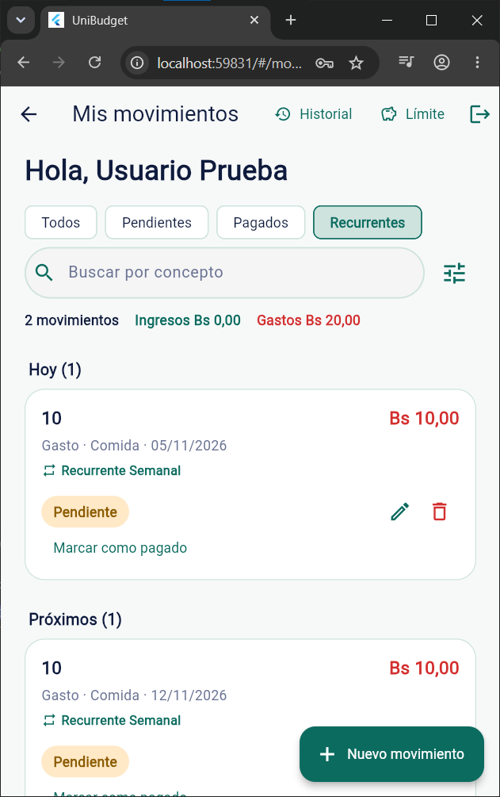

## 7. Prueba con otra persona

**Tarea para el tester, sin darle indicaciones:**

> “Encuentra cuándo se cobra el próximo gasto recurrente y de qué monto es”.

| Aspecto | Resultado |
|---|---|
| ¿La encontró sin ayuda? | Pendiente |
| ¿La encontró con ayuda? | Pendiente |
| ¿No la encontró? | Pendiente |
| ¿Dónde dudó? | Pendiente |
| ¿Qué ajustamos después? | Pendiente |

## 8. Cómo probar en web

1. Levantar el backend:

```bash
cd servidor
docker compose -f docker-compose.dev.yml up -d
```

2. Verificar que el `.env` de la raíz use:

```env
API_BASE_URL=http://localhost:3000
```

3. Ejecutar la app:

```bash
flutter run -d chrome
```

4. Iniciar sesión con:

```text
Correo: prueba@correo.com
Contraseña: 123456
```

5. En “Mis movimientos”, probar los chips **Todos**, **Pendientes** y **Recurrentes**.

6. Para la prueba con otra persona, pedirle que encuentre el próximo gasto recurrente sin indicarle qué chip tocar.

## 9. Enlace al commit

Pendiente de crear el commit de esta mejora.

## 10. Checklist de entrega

- [x] Problema concreto identificado.
- [x] Tarea difícil de encontrar definida.
- [x] Estructura propuesta con chips, etiquetas y acceso.
- [x] Motivo de la decisión.
- [x] Implementación en la app existente.
- [x] Dibujo de la propuesta.
- [x] Capturas del antes.
- [x] Capturas del después.
- [ ] Prueba con otra persona.
- [ ] Enlace al commit.
