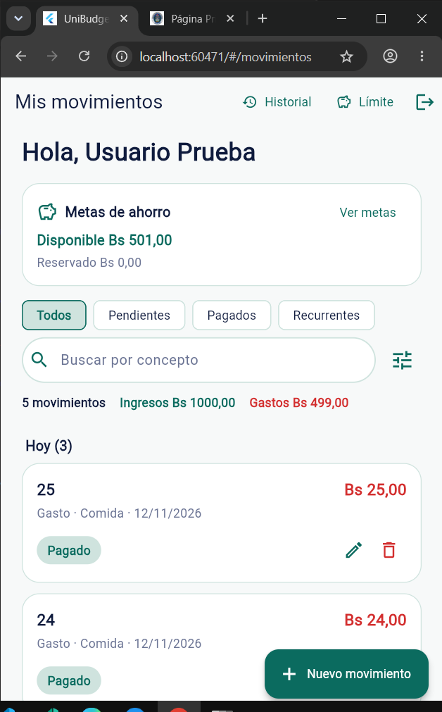
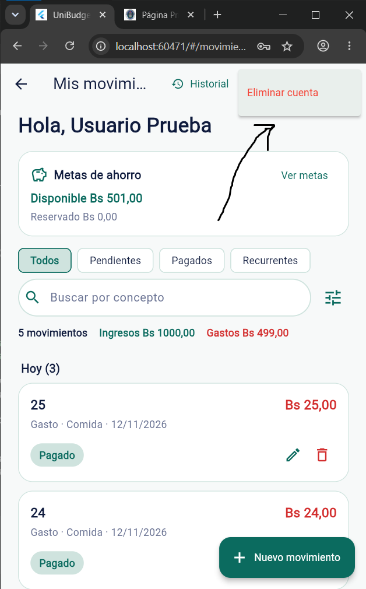

# Clase 22 Patrones oscuros
Integrantes:
- Sebastian Cespedes Rodas
- Adolfo Mendoza Ribera

Modalidad: sin IA

## 1. Patrón encontrado
Tipo (de los seis): 5 — salir cuesta más que entrar.

Dónde: `lib/pantallas/pantalla_movimientos.dart:355` (AppBar) y `servidor/servidor.js:228`. Se puede cerrar sesión con un toque, pero no existe ninguna forma de eliminar la cuenta ni los datos.

Por qué es un patrón oscuro: registrarse e iniciar sesión es directo, y cerrar sesión está a la vista; en cambio, eliminar la cuenta no aparece en ninguna pantalla y el servidor no tiene un endpoint para hacerlo. El usuario no ve que sus datos financieros quedan guardados indefinidamente y no puede ejercer control sobre ellos. Esto beneficia al sistema, que conserva usuarios y datos para retención, y perjudica al usuario, que no puede irse con sus datos ni hacer que se borren.

## 2. Antes
En la pantalla de movimientos solo se ofrece “Cerrar sesión”; no hay una opción para eliminar la cuenta.



Fragmento de código del antes:

```dart
// lib/pantallas/pantalla_movimientos.dart (AppBar)
IconButton(
  tooltip: 'Cerrar sesión',
  icon: const Icon(Icons.logout, color: Colores.verdeOscuro),
  onPressed: _cerrarSesion,
),
// No existe una opción "Eliminar cuenta".
```

```js
// servidor/servidor.js
app.post('/logout', exigirSesion, async (req, res) => {
  await prisma.sesion.deleteMany({ where: { token: req.token } });
  res.json({ mensaje: 'Sesión cerrada' });
});
// No existe DELETE /cuenta.
```

## 3. Después
La AppBar ahora muestra un botón de cuenta (⋮) desde el que se abre “Eliminar cuenta”. El diálogo advierte que se borrarán la cuenta, los movimientos, las metas y los presupuestos, y pide la contraseña antes de confirmar.



Fragmento de código del después:

```dart
// lib/pantallas/pantalla_movimientos.dart (AppBar)
PopupMenuButton<String>(
  tooltip: 'Cuenta',
  icon: const Icon(Icons.more_vert, color: Colores.verdeOscuro),
  onSelected: (valor) {
    if (valor == 'eliminar') unawaited(_eliminarCuenta());
  },
  itemBuilder: (contexto) => const [
    PopupMenuItem(
      value: 'eliminar',
      child: Text(
        'Eliminar cuenta',
        style: TextStyle(color: Colors.red),
      ),
    ),
  ],
),
```

```js
// servidor/servidor.js
app.delete('/cuenta', exigirSesion, async (req, res) => {
  const contrasena = String(req.body?.contrasena || '');
  if (!contrasena) {
    return res.status(400).json({ error: 'Escribe tu contraseña' });
  }

  const usuario = await prisma.usuario.findUnique({
    where: { id: req.usuario.id },
  });
  if (!usuario || !(await bcrypt.compare(contrasena, usuario.contrasenaHash))) {
    return res.status(403).json({ error: 'Contraseña incorrecta' });
  }

  await prisma.usuario.delete({ where: { id: req.usuario.id } });
  res.json({ mensaje: 'Cuenta eliminada' });
});
```

Commit: `fix(etica): permitir eliminar la cuenta y sus datos` (`bccbb7b`).

## 4. Principio aplicado
**Control y libertad (Nielsen #3)**, junto con **minimización de datos y privacidad por defecto**. La opción de eliminar la cuenta está en la misma AppBar que cerrar sesión y con el mismo peso visual, no escondida en ajustes ni detrás de soporte. El diálogo explica el alcance y pide la contraseña para evitar borrados accidentales; al confirmar, el backend elimina al usuario y, por las relaciones `onDelete: Cascade`, también sus movimientos, metas, presupuestos, límites, sesiones y eventos. Así el usuario puede irse y hacer borrar sus datos.

## 5. Prueba
Test: `elimina la cuenta y todos sus datos`, en `servidor/tests/cuenta.test.js`. La misma prueba, ejecutada contra el código anterior, falla porque `DELETE /cuenta` no existía y devolvía 404. Con el después pasa: rechaza una contraseña incorrecta con 403, elimina la cuenta con la contraseña correcta, borra en cascada movimientos y sesiones, y el login posterior devuelve 401. Resultado: `npm test` → 70 pruebas pasan.

## 6. Otros que encontramos
No se corrigió otro patrón en esta entrega. Se revisó la checklist de simetría: el aviso de límite es informativo y no culpa al usuario; los permisos y los datos personales se explican antes de pedirlos. El hallazgo claro fue el #5.
