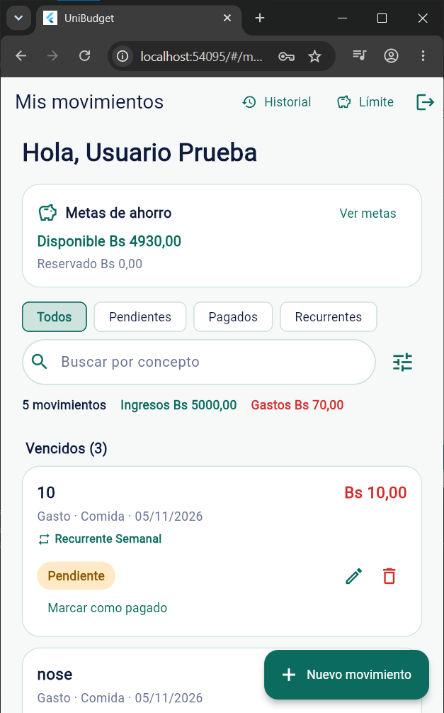
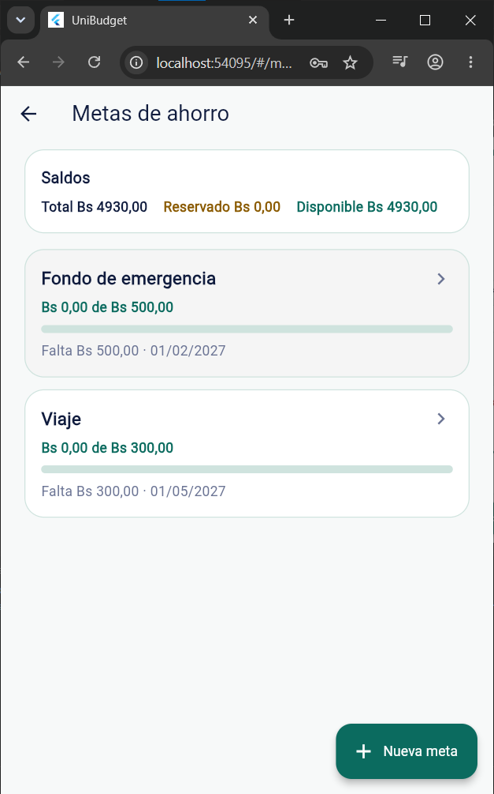
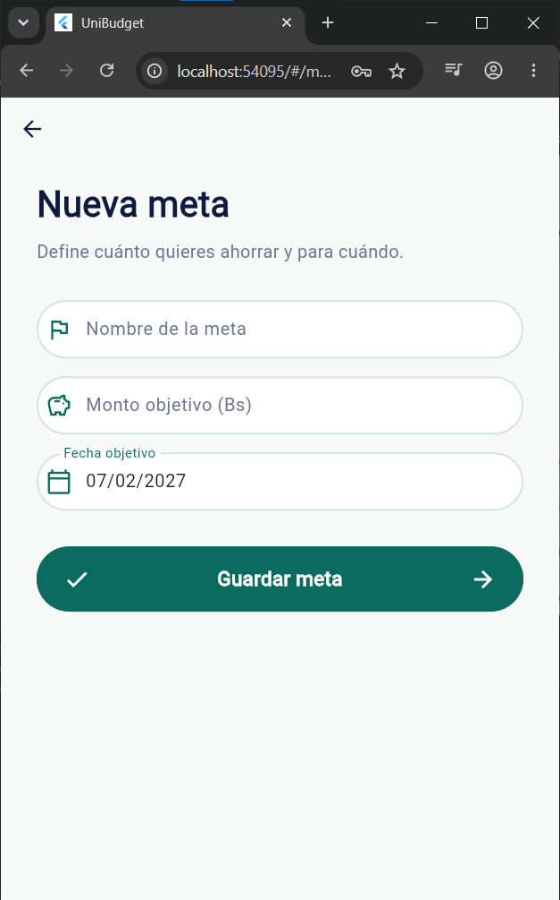
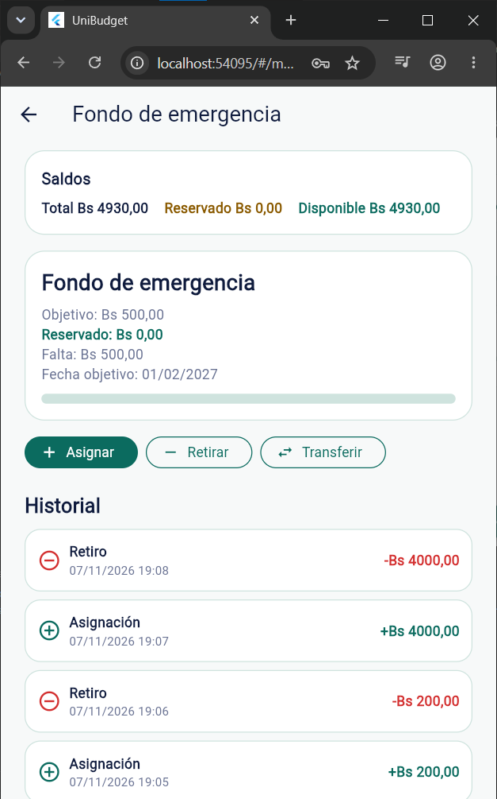

# Tarea 8 — Metas de ahorro con fondos reservados

**Producto:** UniBudget — Presupuesto Estudiantil  
**Integrantes:** Sebastián Céspedes Rodas — Adolfo Mendoza Ribera  
**Entrega:** martes 10/11/2026, 18:00

## 1. Funcionalidad

Se agregaron **metas de ahorro** con dinero reservado. Una meta tiene:

- Nombre.
- Monto objetivo.
- Fecha objetivo.
- Monto reservado actualmente.

El dinero reservado sigue siendo parte del saldo total, pero deja de estar disponible para gastar.

## 2. Los tres saldos

- **Saldo total** = ingresos − gastos.
- **Fondos reservados** = suma de dinero asignado a las metas.
- **Saldo disponible** = saldo total − fondos reservados.

## 3. Operaciones implementadas

1. Crear una meta con nombre, monto objetivo y fecha.
2. Asignar fondos desde el saldo disponible hacia una meta.
3. Retirar fondos de una meta y devolverlos al disponible.
4. Transferir fondos de una meta a otra.

## 4. Reglas

- No se puede asignar más que el saldo disponible.
- No se puede retirar más que lo reservado en la meta.
- No se puede transferir más que lo reservado en la meta de origen.
- Una transferencia no cambia el total reservado: solo mueve dinero entre metas.
- Un retiro no cambia el saldo total: mueve dinero de reservado a disponible.
- Las operaciones de metas **no crean ingresos ni gastos ficticios**.
- Las operaciones se ejecutan en transacciones: si no hay fondos, se rechazan sin dejar cambios a medias.
- Se conserva el historial de asignaciones, retiros y transferencias.

## 5. Implementación

### Backend

- Modelos Prisma `MetaAhorro` y `MovimientoMeta`.
- Migración `20261105180000_metas_ahorro`.
- Reglas puras en `servidor/metas.js`.
- Endpoints:
  - `GET /metas`
  - `POST /metas`
  - `POST /metas/:id/asignar`
  - `POST /metas/:id/retirar`
  - `POST /metas/:id/transferir`
  - `GET /metas/:id/movimientos`
- Las transferencias generan un movimiento de salida y otro de entrada.
- Las consultas siempre filtran por `usuarioId`.

### Flutter

- Tarjeta **“Metas de ahorro”** en “Mis movimientos” con disponible y reservado.
- Pantalla **“Metas de ahorro”** con saldos y lista de metas.
- Pantalla **“Nueva meta”** con nombre, monto objetivo y fecha.
- Pantalla de detalle con:
  - Progreso de la meta.
  - Acciones **Asignar**, **Retirar** y **Transferir**.
  - Historial de movimientos.
- Ruta `/metas`.

### Semilla

`prisma/semilla.js` ahora:

- Crea o actualiza el usuario `prueba@correo.com / 123456`.
- Si el usuario no tiene movimientos, crea un ingreso de Bs 1000 y un gasto de Bs 400.
- Si no tiene metas, crea `Fondo de emergencia` y `Viaje`.

## 6. Evidencia visual

### Mis movimientos



Se observa la tarjeta **“Metas de ahorro”** con el disponible y el reservado, además de los chips de movimientos.

### Metas de ahorro



Se observan los saldos **Total**, **Reservado** y **Disponible**, y las metas `Fondo de emergencia` y `Viaje`.

### Nueva meta



Formulario con nombre, monto objetivo y fecha objetivo.

### Detalle de la meta



Se observan las acciones **Asignar**, **Retirar** y **Transferir**, y el historial de movimientos de la meta.

> Nota: en los archivos, `image3.png` corresponde a “Nueva meta” y `image4.png` al detalle de la meta.

## 7. Pruebas

### Backend

```text
npm test
65 tests passed
```

Incluye pruebas unitarias de saldos y validaciones, y una prueba de integración API + base de datos con el recorrido:

- Ingresos Bs 1000 y gastos Bs 400.
- Dos metas.
- Asignación de Bs 200 y Bs 100.
- Transferencia de Bs 50.
- Retiro de Bs 100.
- Intento de asignar Bs 500 rechazado.
- Verificación de saldos e historial.

### Flutter

```text
flutter test
41 tests passed
```

### Build web

```text
flutter build web
Built build/web
```

### E2E

Se prepararon las pruebas en `integration_test/metas_test.dart`:

- Recorrido completo con dos metas, asignación, transferencia, retiro, intento sin fondos y persistencia al reiniciar la app.
- Restricción de nombres duplicados.

No se ejecutaron en este entorno porque se evitó levantar emuladores. Quedan listas para ejecutarse en el dispositivo o emulador asignado.

## 8. Cómo probar

1. Levantar el backend:

```bash
cd servidor
docker compose -f docker-compose.dev.yml up -d
```

2. Configurar la URL de la API en el `.env` de la raíz según el dispositivo:

```env
# Emulador Android
API_BASE_URL=http://10.0.2.2:3000
```

3. Ejecutar la app en mobile:

```bash
flutter run
```

4. Iniciar sesión con:

```text
Correo: prueba@correo.com
Contraseña: 123456
```

5. Entrar a **Metas de ahorro** desde la tarjeta de “Mis movimientos”.
